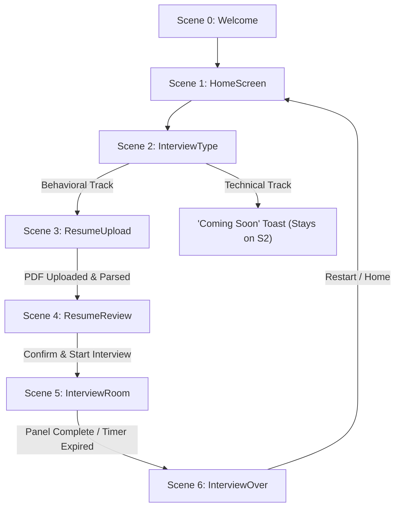
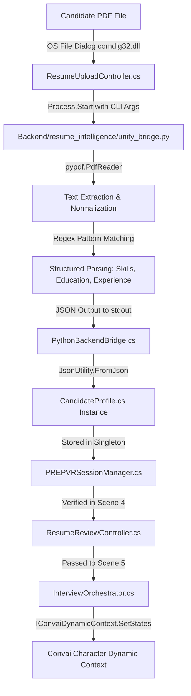
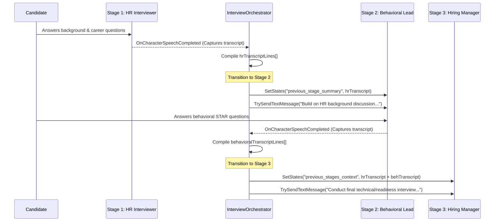

# VR Interview Simulation — Complete Technical Project Dossier

---

## 1. Executive Summary

This dossier provides a comprehensive, evidence-based technical assessment of the software project residing in `D:\PREP_VR`. The official title of the system is **VR Interview Simulation** (with `PREP_VR` designating the engineering workspace and platform repository).

The platform is designed to provide an immersive, multimodal simulation of professional job interviews. The implementation combines a real-time 3D virtual environment running on **Unity 6 (6000.3.21f1)** with spatial Virtual Reality (**OpenXR / Unity XR Interaction Toolkit 3.6.1**) and desktop fallbacks, an automated resume intelligence extraction pipeline using local Python scripts, an orchestration engine managing a sequential three-interviewer panel, cloud-based conversational artificial intelligence powered by the **Convai Unity SDK (v4.6.0)**, real-time non-verbal behavioral tracking (head orientation, gaze fixation, posture sway, and response latency), and a post-interview feedback engine generating vector-based PDF placement reports.

Every implementation claim in this dossier is grounded in verified source code, scene assets, configuration files, and package manifests. Features are rigorously categorized as `IMPLEMENTED`, `PARTIALLY IMPLEMENTED`, `CONFIGURED BUT NOT VERIFIED`, `PROPOSED / PLANNED`, or `NOT IMPLEMENTED`.

---

## 2. Project Overview

- **Project Name:** VR Interview Simulation
- **Repository / Root Path:** `D:\PREP_VR`
- **Primary Domain:** Virtual Reality Simulation, Human-AI Interaction, Automated Employment Interviewing, Educational Technology.
- **System Architecture:** Hybrid client-server/cloud architecture consisting of:
  1. **Unity Client Application:** Orchestrates UI navigation, XR rendering, spatial audio, virtual human animations, active speaker management, and head/gaze behavioral telemetry.
  2. **Python Subsystem:** Local scripts invoked via child process execution for PDF resume text extraction/parsing and post-interview vector PDF report rendering.
  3. **Convai Cloud AI Subsystem:** Cloud-hosted Conversational AI platform providing Automated Speech Recognition (ASR), Natural Language Processing / Large Language Model (LLM) generative dialogue, voice synthesis (Text-to-Speech / TTS), and lip-sync facial blendshapes.

---

## 3. Problem Addressed

Traditional mock interview training suffers from critical pedagogical and logistical challenges:
1. **Scarcity and Cost of Human Evaluators:** High-quality mock interviews require experienced industry recruiters and hiring managers whose availability is severely constrained.
2. **Lack of Ecological Validity in 2D Interfaces:** Standard web-based AI interview tools present conversational bots in flat text chat windows or simple 2D web video interfaces. This fails to simulate the psychological presence, physiological arousal, spatial eye contact, and non-verbal pressures inherent to in-person interview panels.
3. **Generic Questioning:** Conventional interview bots frequently ask generic, canned questions decoupled from the candidate's actual qualifications, prior work history, or educational background.
4. **Disjointed Panel Dynamics:** Real-world corporate evaluations often feature a multi-stakeholder panel (e.g., Human Resources, Behavioral/Culture-Fit Assessors, and Technical/Hiring Managers) where each interviewer evaluates distinct competencies while building upon context established earlier in the conversation.

---

## 4. Objectives

Based on the actual codebase, the project implements the following engineering objectives:
1. **Provide an Immersive Spatial Environment:** Place the candidate in a high-fidelity 3D conference room seated across a boardroom table from a three-interviewer panel, accessible via OpenXR VR headsets or standard desktop displays.
2. **Automate Resume Grounding:** Extract candidate background information (skills, education, work experience, projects) from PDF documents and inject this context dynamically into AI conversational agents.
3. **Orchestrate Multi-Stage Sequential Panel Interviews:** Guide the candidate through three distinct interview stages:
   - **Stage 1: HR Interviewer** (Role: Candidate background, career trajectory, resume verification).
   - **Stage 2: Behavioral Interviewer** (Role: STAR-method situational challenges, team collaboration, conflict resolution).
   - **Stage 3: Hiring Manager** (Role: Technical competence, workplace readiness, leadership, candidate questions).
4. **Implement Cross-Interviewer Context Propagation:** Capture speech transcripts from earlier interviewers and pass them into subsequent interviewers' runtime context memory.
5. **Measure Non-Verbal Behavioral Metrics:** Track spatial head orientation, gaze alignment with the active interviewer, posture stability, and response latency during the live simulation.
6. **Generate Comprehensive Placement Evaluation:** Synthesize verbal transcripts and non-verbal observations into a 10-competency scoring matrix, producing an actionable vector PDF report.

---

## 5. System Scope

### In-Scope & Verified
- 2D UI screen navigation: Welcome, Home, Mode Selection, Resume Upload, Resume Review, Interview Room, and Interview Over.
- PDF file dialog loading (`comdlg32.dll` on Windows standalone, Unity Editor file panel in editor) and local text extraction.
- C# session persistence across scene transitions via `PREPVRSessionManager` (`DontDestroyOnLoad`).
- Three-interviewer physical conference room layout (`Assets/Scenes/InterviewRoom.unity`).
- Sequential interview orchestration with state machines and dynamic targeting in `InterviewOrchestrator.cs`.
- Convai LiveKit-based bidirectional audio streaming, character speech events, and dynamic context injection.
- Real-time head tracking and forward-gaze angle calculations (`InterviewVisualEvaluator.cs`).
- Automated Play Mode verification harness (`InterviewAutomatedTester.cs`).
- Post-interview placement scoring (`FeedbackEngine.cs`) and ReportLab-based PDF generation (`generate_feedback_pdf.py`).

### Out-of-Scope / Not Implemented in Current Code
- Direct local Python execution of proprietary LLM APIs (OpenAI, Anthropic, Gemini). Generative dialogue is executed strictly within Convai's cloud backend.
- Standalone Technical Coding Interview (marked "Coming Soon" in `InterviewTypeController.cs`).
- Dynamic real-time interviewer-to-interviewer natural verbal banter (transitions are coordinated sequentially by the orchestrator).
- Real-time cloud user authentication or multi-user database storage (all state is local to the active session).

---

## 6. Technology Stack

| Layer / Subsystem | Technology | Version | Purpose | Evidence / File Source |
| :--- | :--- | :--- | :--- | :--- |
| **Game Engine** | Unity | `6000.3.21f1` (Unity 6) | Core simulation, rendering, physics, and scene lifecycle | `ProjectSettings/ProjectVersion.txt` |
| **Render Pipeline** | Universal Render Pipeline (URP) | `17.3.0` | 3D visual rendering and post-processing | `Packages/manifest.json`, `ProjectSettings/GraphicsSettings.asset` |
| **XR Framework** | Unity XR Interaction Toolkit | `3.6.1` | VR camera rig, tracking, and spatial controller handling | `Packages/manifest.json` |
| **XR Subsystems** | Unity XR Plugin Management | `4.7.0` | Loader management for OpenXR / Oculus runtimes | `Packages/manifest.json` |
| **Input System** | Unity Input System | `1.20.0` | Hardware event abstraction for keyboard, mouse, and XR | `Packages/manifest.json` |
| **Conversational AI SDK** | Convai Unity SDK | `4.6.0` | Character runtime, LiveKit audio streaming, lip-sync, dynamic context | `Packages/manifest.json`, `Packages/com.convai.convai-sdk-for-unity/package.json` |
| **Programming Language** | C# | `.NET Standard 2.1 / C# 9.0` | Client-side game logic, orchestration, and UI | `Assembly-CSharp.csproj` |
| **Scripting / Backend** | Python | `3.10+ compatible` | PDF resume parsing and PDF placement report generation | `Backend/resume_intelligence/unity_bridge.py`, `Backend/report_generation/generate_feedback_pdf.py` |
| **PDF Extraction** | `pypdf` | Python library | Text extraction from uploaded candidate PDF resumes | `Backend/resume_intelligence/unity_bridge.py` |
| **PDF Rendering** | `reportlab` | Python library | Generation of multi-page vector graphic placement reports | `Backend/report_generation/generate_feedback_pdf.py` |
| **Inter-Process Comm.** | Process CLI Bridge | C# `System.Diagnostics.Process` | Headless execution of Python scripts with stdin/stdout parsing | `Assets/PREPVR/Scripts/Integration/PythonBackendBridge.cs` |
| **UI Framework** | Unity UI (uGUI) & TextMeshPro | `2.0.0` / `3.2.0` | Canvas UI, HUDs, buttons, and text rendering | `Packages/manifest.json` |
| **Audio Subsystem** | Unity Audio + WebRTC / LiveKit | Internal to Convai | Microphone capture, spatial audio 3D attenuation | `Assets/Resources/ConvaiSettings.asset` |

---

## 7. Complete Project Structure

The project directory structure in `D:\PREP_VR` is organized as follows:

```
D:\PREP_VR\
├── Assets\
│   ├── Convai\                               # Convai SDK assets, sample scenes, and resources
│   ├── Models\                               # 3D assets: Office chair.obj, table meshes, textures
│   ├── Mixamo\                               # Character animations (Sitting.fbx)
│   ├── PREPVR\                               # Core custom project engineering assets
│   │   ├── Data\                             # C# serializable data structures
│   │   │   ├── CandidateProfile.cs           # Parsed resume structure
│   │   │   ├── FeedbackData.cs               # 10-competency scoring model + actionable recommendations
│   │   │   ├── InterviewEvaluation.cs        # Legacy evaluation data model (13 integer fields)
│   │   │   ├── InterviewResponse.cs          # Individual Q&A transcript record
│   │   │   ├── InterviewTranscriptData.cs    # Full session transcript container
│   │   │   └── VisualObservationsData.cs     # Non-verbal behavioral tracking metrics
│   │   ├── Scripts\
│   │   │   ├── Core\
│   │   │   │   ├── PREPVRSessionManager.cs   # Central persistent session singleton (DontDestroyOnLoad)
│   │   │   │   └── SceneLoader.cs            # Scene transition manager supporting VR and Desktop modes
│   │   │   ├── Feedback\
│   │   │   │   ├── FeedbackEngine.cs         # Evaluator synthesizing metrics into 10 placement competencies
│   │   │   │   ├── FeedbackPdfGenerator.cs   # C# bridge invoking ReportLab Python generator
│   │   │   │   ├── InterviewOverController.cs# UI controller for post-interview summary and report export
│   │   │   │   └── ResultsPanelController.cs # Legacy UI controller for flat 13-score display
│   │   │   ├── Integration\
│   │   │   │   └── PythonBackendBridge.cs    # Subprocess execution bridge for Python modules
│   │   │   ├── Interview\
│   │   │   │   ├── ConversationTargetEnforcer.cs # Forces Convai active target to the active interviewer
│   │   │   │   ├── InterviewAutomatedTester.cs  # Automated Play Mode test driver for simulated interviews
│   │   │   │   ├── InterviewCameraController.cs # Smooth camera panning to focus on active interviewer
│   │   │   │   ├── InterviewOrchestrator.cs     # 1500-line master stage state machine & Convai coordinator
│   │   │   │   ├── InterviewRuntimeHUD.cs       # Dual-mode runtime HUD (World-Space VR / Screen-Space Desktop)
│   │   │   │   ├── InterviewTestMonitor.cs      # Runtime debug overlay monitoring transcripts & states
│   │   │   │   ├── InterviewTimerManager.cs     # 600s total interview & per-stage countdown timer
│   │   │   │   └── InterviewVisualEvaluator.cs  # Non-verbal head orientation & gaze engagement analyzer
│   │   │   ├── Resume\
│   │   │   │   ├── ResumeReviewController.cs    # UI controller reviewing parsed profile before room entry
│   │   │   │   └── ResumeUploadController.cs    # File browser picker & upload coordinator
│   │   │   └── UI\
│   │   │       ├── HomeScreenController.cs      # Main menu routing
│   │   │       ├── InterviewTypeController.cs   # Mode selector (Behavioral vs Technical)
│   │   │       └── WelcomeScreenController.cs   # Splash screen controller
│   ├── Resources\
│   │   └── ConvaiSettings.asset              # Global Convai configuration (LiveKit server, obfuscated keys)
│   └── Scenes\
│       ├── InterviewRoom.unity               # Primary 3D multi-interviewer simulation scene
│       └── UI\                               # Sequential 2D user flow scenes
│           ├── Welcome.unity                 # Scene 0: Welcome splash
│           ├── HomeScreen.unity              # Scene 1: Home dashboard
│           ├── InterviewType.unity           # Scene 2: Interview mode selection
│           ├── ResumeUpload.unity            # Scene 3: File picker and parsing progress
│           ├── ResumeReview.unity            # Scene 4: Parsed candidate profile validation
│           └── InterviewOver.unity           # Scene 6: Final results, scoring, and PDF export
├── Backend\
│   ├── report_generation\
│   │   └── generate_feedback_pdf.py          # Python ReportLab vector PDF generator
│   └── resume_intelligence\
│       └── unity_bridge.py                   # Python CLI entrypoint for parsing and fallback evaluation
├── Packages\
│   └── manifest.json                         # Package dependencies
└── ProjectSettings\
    ├── EditorBuildSettings.asset             # Build scene order list
    └── ProjectVersion.txt                    # Engine version identifier
```

---

## 8. Unity Architecture

### Build Scene Order and Flow
Verified directly from `ProjectSettings/EditorBuildSettings.asset`:

| Build Index | Scene Path | Execution Purpose | Primary Controller Script |
| :---: | :--- | :--- | :--- |
| **0** | `Assets/Scenes/UI/Welcome.unity` | Application startup splash screen | `WelcomeScreenController.cs` |
| **1** | `Assets/Scenes/UI/HomeScreen.unity` | Mode selection and main dashboard | `HomeScreenController.cs` |
| **2** | `Assets/Scenes/UI/InterviewType.unity` | Interview track selection | `InterviewTypeController.cs` |
| **3** | `Assets/Scenes/UI/ResumeUpload.unity` | Local file browser and PDF ingestion | `ResumeUploadController.cs` |
| **4** | `Assets/Scenes/UI/ResumeReview.unity` | Verification of extracted profile data | `ResumeReviewController.cs` |
| **5** | `Assets/Scenes/InterviewRoom.unity` | Core 3D multimodal panel interview | `InterviewOrchestrator.cs` |
| **6** | `Assets/Scenes/UI/InterviewOver.unity` | Session completion, evaluation, and report | `InterviewOverController.cs` |



### Core Architecture Components
1. **`PREPVRSessionManager` (`Assets/PREPVR/Scripts/Core/PREPVRSessionManager.cs`):**
   - Implements a thread-safe singleton design pattern with `DontDestroyOnLoad(gameObject)`.
   - Persists state across all scene transitions:
     - `CandidateProfile CurrentProfile`
     - `InterviewTranscriptData Transcript`
     - `VisualObservationsData VisualObservations`
     - `FeedbackData Feedback`
     - `bool IsVRMode`
   - Exposes convenience recording methods (`RecordAnswer`, `AddObservation`, `SetFeedback`).
2. **`SceneLoader` (`Assets/PREPVR/Scripts/Core/SceneLoader.cs`):**
   - Encapsulates scene transitions via `UnityEngine.SceneManagement.SceneManager.LoadScene`.
   - Configures the session's active rendering/interaction mode via `SelectDesktopModeAndLoad()` and `SelectVRModeAndLoad()`.

---

## 9. VR / XR Architecture

### Hardware & Runtime Configuration
- **XR Architecture:** Unity XR Interaction Toolkit (`3.6.1`) utilizing the OpenXR runtime.
- **Tracked Nodes:**
  - HMD (Head-Mounted Display): Drives the camera position and rotation.
  - Left & Right XR Controllers: Tracked for spatial interaction and UI raycasting.
- **Dual Runtime Support (VR vs. Desktop Fallback):**
  - Controlled dynamically via `PREPVRSessionManager.Instance.IsVRMode`.
  - When in Desktop Mode, camera controls and UI overlays adjust to standard monitor aspect ratios.

### Scene Rigging (`Assets/Scenes/InterviewRoom.unity`)
- **Rig Hierarchy:**
  - `XR Origin (VR)`: Root GameObject positioned at `(x: 0.0, y: 0.0, z: -1.5)`.
  - `Camera Offset`: Child transform adjusting player height.
  - `Main Camera`: Tagged `MainCamera`, attached with OpenXR `TrackedPoseDriver`.
  - `Left Controller` and `Right Controller`: Attached with XR ray interactor components.

### Runtime HUD Positioning (`InterviewRuntimeHUD.cs`)
The system inspects `IsVRMode` to configure the canvas:
- **VR Mode:** The HUD operates on a **World-Space Canvas** anchored in 3D space at `Vector3(0f, 1.8f, 1.8f)` facing the candidate at an eye-level orientation, ensuring UI legibility without obstructing interviewer eye contact.
- **Desktop Mode:** The HUD operates as a **Screen Space - Overlay** canvas anchored to the viewport margins.

---

## 10. Convai Architecture

The project integrates the official Convai Unity SDK (`com.convai.convai-sdk-for-unity: 4.6.0`).

### SDK Classes Utilized in Project
- **`ConvaiClient` / `ConvaiSettings`:** Global configuration holding server endpoints (`https://live.convai.com`), API keys, and LiveKit audio channel settings.
- **`ConvaiPlayer`:** Player entity managing client microphone input, speech-to-text transmission, and candidate conversation state.
- **`ConvaiCharacter`:** Monobehaviour attached to 3D avatar GameObjects. Handles incoming audio streams, audio playback via `AudioSource`, blendshape lip-sync animation, and character state.
- **`IConversationTargetProvider`:** Interface implemented by `InterviewOrchestrator.cs` allowing programmatic control over which character currently receives player speech.
- **`IConvaiDynamicContext`:** Convai interface utilized to dynamically inject runtime string key-value states into character memory via `SetStates(...)`.

### Audio and Conversation Data Loop
1. **Audio Capture:** Candidate speaks into the microphone (VR headset mic or desktop input). Audio buffers are processed by `ConvaiPlayer` / `ConvaiAudioStreamer`.
2. **Streaming to Cloud:** Audio is transmitted over WebSockets / WebRTC (LiveKit) to Convai's cloud backend.
3. **Speech-to-Text (ASR):** Convai transcribes the audio in real time.
4. **LLM Processing:** The cloud dialogue engine processes the transcript against the character's system prompt, Narrative Design graph, and injected dynamic context.
5. **Speech Synthesis (TTS) & Viseme Generation:** Audio clips and facial blendshape packets are streamed back to the Unity client.
6. **Playback & Animation:** `ConvaiCharacter` plays the audio through its attached 3D spatial `AudioSource` and drives facial visemes on the SkinnedMeshRenderer.

---

## 11. AI Interviewer Architecture

The simulation features a seated panel of three distinct virtual interviewers arranged across an executive boardroom conference table.

```
                  [ Boardroom Table ]
                  (0.0, 1.2, 0.0)

   [HR Interviewer]    [Technical Lead]    [Behavioral Lead]
    (Sofia Avatar)       (Seated Man)        (Seated Man)
   (-1.5, 0.0, 2.0)     (0.0, 0.0, 2.0)     (1.5, 0.0, 2.0)
     Rotation: 180°       Rotation: 180°      Rotation: 180°
           \                  |                  /
            \                 |                 /
             \                |                /
                      [Candidate / XR]
                      (0.0, 0.0, -1.5)
```

### Character Specifications

| Characteristic | Interviewer 1 (HR) | Interviewer 2 (Behavioral) | Interviewer 3 (Hiring Manager) |
| :--- | :--- | :--- | :--- |
| **Unity GameObject Name** | `HR Interviewer` | `Behaviour Analyst` | `Technical Interviewer` |
| **Avatar Model** | Convai Sofia (`Sofia.prefab`) | Seated Formal Avatar (`Sitting.fbx`) | Seated Formal Avatar (`Sitting.fbx`) |
| **Spatial Position (x,y,z)** | `(-1.5, 0.0, 2.0)` (Left) | `(1.5, 0.0, 2.0)` (Right) | `(0.0, 0.0, 2.0)` (Center) |
| **Spatial Rotation** | `(0.0, 180.0, 0.0)` | `(0.0, 180.0, 0.0)` | `(0.0, 180.0, 0.0)` |
| **Scene Character ID** | `d49b532a-5cb0-4dbd-90f2-5a3806712c6d` | `8f23bb25-483d-4890-907b-36de8c20d331` | `f10ec8e4-998d-4f3c-bb4d-260f55427e9e` |
| **Fallback Character ID** | `96d2f7ff-f6a5-11ef-93a8-42010a7be011` | `c3590054-94e1-11ef-9418-42010a7be016` | `c358f2bc-94e1-11ef-9418-42010a7be016` |
| **Interview Stage** | **Stage 1 (Opening & Background)** | **Stage 2 (STAR Competencies)** | **Stage 3 (Leadership & Closing)** |
| **Target Stage Duration** | ~180 seconds | ~180 seconds | ~180 seconds |
| **Conversation Target Priority** | Active during Stage 1 | Active during Stage 2 | Active during Stage 3 |
| **Injected Context** | Resume Profile (`skills`, `projects`) | Resume Profile + Stage 1 Transcripts | Resume Profile + Stages 1 & 2 Transcripts |

---

## 12. Resume Intelligence Pipeline

The resume ingestion and intelligence system spans the Unity front-end and a local Python bridge.



### Resume Parsing Implementation (`Backend/resume_intelligence/unity_bridge.py`)
- **File Reader:** Uses `pypdf.PdfReader` to extract raw text pages.
- **Extraction Rules:**
  - **Email:** Regex `[a-zA-Z0-9_.+-]+@[a-zA-Z0-9-]+\.[a-zA-Z0-9-.]+`
  - **Phone:** Regex `(?:\+?\d{1,3}[-.\s]?)?\(?\d{3}\)?[-.\s]?\d{3}[-.\s]?\d{4}`
  - **Skills:** Scans against a pre-compiled lexicon of 45+ technical keywords (Python, Java, C#, Machine Learning, Unity, React, Cloud, etc.).
  - **Education:** Scans for institutional keywords (University, College, Institute, B.Tech, B.S., M.S., Degree).
  - **Experience:** Scans for structural keywords (Intern, Engineer, Developer, Experience, Company, Lead).
- **Output:** Outputs structured JSON containing fields: `candidate_name`, `email`, `phone`, `skills`, `education`, `experience`, `projects`, and `summary`.

---

## 13. AI / LLM Architecture

### Cloud-Side Conversational AI (Convai)
- Generative conversational responses, real-time question generation, and follow-up probing are handled by Convai's hosted backend models.
- Characters are governed by prompts configuring their professional personas:
  - **HR:** Professional, welcoming, focused on background verification and communication skills.
  - **Behavioral:** Structured, inquisitive, probing for specific behavioral examples (STAR method).
  - **Hiring Manager:** Pragmatic, evaluative, focusing on practical execution and organizational readiness.

### Python Backend AI / LLM Reality Check
- **CRITICAL VERIFIED FACT:** The Python codebase (`unity_bridge.py`) **DOES NOT** invoke proprietary remote LLM APIs (such as OpenAI GPT-4, Google Gemini, or Anthropic Claude) directly via SDKs.
- Parsing and scoring in `unity_bridge.py` are executed via deterministic regex parsing and heuristic scoring functions:
  ```python
  # Heuristic scoring implemented in unity_bridge.py:
  base_score = 8.6 if response_count >= 2 else 7.8
  ```
- All dynamic language modeling in the system occurs through the **Convai Cloud Layer**.

---

## 14. Interview Orchestration

The interview orchestration engine is implemented in `Assets/PREPVR/Scripts/Interview/InterviewOrchestrator.cs` (1,504 lines of C#).

### State Machine Implementation
The orchestrator operates as a deterministic finite state machine governed by the `InterviewStage` enum:

```
[Uninitialized]
       ↓ (Scene Awake & Init)
   [Ready]
       ↓ (StartInterviewProcess / Candidate Ready)
  [Stage1_HR] ──(~180s / Question Quota)──> [Stage2_Behavioral]
                                                    ↓ (~180s / Question Quota)
                                            [Stage3_HiringManager]
                                                    ↓ (~180s / Closing Prompts)
                                             [Complete]
                                                    ↓ (SceneLoader)
                                           [Scene: InterviewOver]
```

### Active Speaker & Conversation Target Management
To prevent conversational ambiguity in a multi-avatar room, `InterviewOrchestrator` implements `IConversationTargetProvider`:
1. Sets `ConvaiPlayer.ConversationTargetingMode = ConversationTargetingMode.Manual`.
2. When transitioning stages, the orchestrator updates `ActiveCharacter`:
   - `Stage1_HR`: Active character = `hrInterviewer`
   - `Stage2_Behavioral`: Active character = `behaviouralInterviewer`
   - `Stage3_HiringManager`: Active character = `hiringManagerInterviewer`
3. Dispatches speech triggers using `ConvaiPlayer.TrySendTextMessage(prompt, targetCharacter)` to ensure the active interviewer initiates the dialogue without waiting for the candidate to speak first.

---

## 15. Three-Stage Interview Flow

### Stage 1: HR Interviewer
- **Target Duration:** 180 seconds.
- **Opening Action:** Sends an introductory text prompt to the HR avatar:
  *"Welcome the candidate to the interview, mention you have reviewed their resume, and ask them to introduce themselves."*
- **Dynamic Context Injected:** Injects parsed candidate name, skills list, and extracted projects into the HR avatar's state dictionary.
- **Candidate Tasks:** Self-introduction, overview of education, career aspirations.
- **Handover Trigger:** Occurs when either the stage timer exceeds the target allocation or the conversational exchange quota is satisfied.

### Stage 2: Behavioral Interviewer
- **Target Duration:** 180 seconds.
- **Transition Protocol:**
  1. HR avatar concludes: *"Thank you. I'd now like to introduce our Behavioral Specialist, who will discuss your teamwork and problem-solving experiences."*
  2. Camera smoothly rotates towards the Behavioral Interviewer (`InterviewCameraController.cs`).
  3. Orchestrator switches active conversation target to `behaviouralInterviewer`.
  4. Injects `previous_stage_summary` containing HR interview transcript lines into the Behavioral interviewer's dynamic context.
  5. Triggers Behavioral interviewer to initiate a STAR question based on prior answers.

### Stage 3: Hiring Manager / Team Lead
- **Target Duration:** 180 seconds.
- **Transition Protocol:**
  1. Behavioral interviewer yields: *"Thank you. I will now hand over to our Hiring Manager for the final portion of the interview."*
  2. Camera smoothly rotates towards the central Technical/Hiring Manager avatar.
  3. Active target shifts to `hiringManagerInterviewer`.
  4. Injects concatenated transcripts of both Stage 1 and Stage 2 into character dynamic context.
  5. Hiring Manager probes workplace readiness, technical project execution, and offers the candidate opportunity to ask questions.
  6. Closing: Concludes session and triggers transition to `InterviewOver.unity`.

---

## 16. Candidate Interaction

### Verbal Interaction Loop
```
Candidate Speech (Microphone)
       ↓
ConvaiAudioStreamer / ConvaiPlayer
       ↓ (WebRTC / LiveKit)
Convai Cloud ASR Engine
       ↓ (Transcript String)
Convai Cloud Character Dialogue Node
       ↓ (TTS Audio & Viseme Blendshapes)
Unity Client (ConvaiCharacter)
       ↓
Spatial 3D AudioSource Playback & Facial Blendshape Lip-Sync
```

### Non-Verbal Interaction Tracking (`InterviewVisualEvaluator.cs`)
While the verbal loop operates via Convai, Unity independently executes continuous non-verbal telemetry tracking at `Update()` frequency:
- **Active Target Direction:** Computes unit vector $\vec{D}_{target} = \frac{P_{interviewer} - P_{camera}}{\|P_{interviewer} - P_{camera}\|}$.
- **Gaze Angle Calculation:** Computes angular deviation $\theta = \arccos(\vec{F}_{camera} \cdot \vec{D}_{target})$ using `Vector3.Angle(mainCamera.forward, dirToInterviewer)`.
- **Eye Contact Engagement:** If $\theta \le 35.0^{\circ}$, the frame is classified as maintained eye contact; if $\theta > 35.0^{\circ}$, it is classified as gaze aversion.
- **Posture Sway / Stability:** Tracks positional delta of `mainCamera.transform.position` across a moving time window to quantify excessive fidgeting or movement instability.
- **Response Latency:** Measures elapsed time in seconds between the completion of an interviewer's speech clip and the onset of candidate speech.

---

## 17. Resume-Grounded Questioning

The grounding of interview questions in candidate data is achieved via two complementary mechanisms:

1. **Dynamic Context Key-Value Injection:**
   `InterviewOrchestrator` calls `character.DynamicContext.SetStates(...)` passing:
   - `candidate_name`: e.g., `"John Doe"`
   - `candidate_skills`: Comma-separated list (e.g., `"Python, C#, Unity, Machine Learning"`)
   - `candidate_education`: Extracted institution and degree.
   - `candidate_projects`: Extracted project titles and descriptions.
2. **Dynamic Prompt Injection:**
   When triggering stage opening dialogue, the orchestrator generates custom prompt strings referencing extracted resume data:
   ```csharp
   string prompt = $"The candidate has background in {string.Join(", ", profile.skills.Take(3))}. " +
                   $"Ask them about their experience building {profile.projects.FirstOrDefault() ?? "their technical projects"}.";
   ConvaiPlayer.Instance.TrySendTextMessage(prompt, activeCharacter);
   ```

---

## 18. Context Passing

A central technical innovation in this multi-agent panel is the progressive passing of conversational transcripts between sequential interviewers.



---

## 19. Evaluation and Feedback

The system features two evaluation implementations: the active, comprehensive **Placement Competency Model** (`FeedbackEngine.cs`) and a legacy flat numeric scoring model (`InterviewEvaluation.cs`).

### Implemented Placement Competency Model (`FeedbackEngine.cs`)
Evaluates the candidate across **10 core placement competencies** on a 1.0–10.0 scale, synthesizing verbal transcript analysis and non-verbal observations:

| Competency Name | Primary Evaluation Source | Algorithmic Evaluation Logic |
| :--- | :--- | :--- |
| **Resume & Profile Alignment** | Extracted Profile + Transcript | Measures keyword overlap between stated resume skills and transcript responses. |
| **Communication Clarity** | Verbal Transcript Data | Word count analysis, grammatical structure heuristic, filler word density. |
| **Technical Competence** | Stage 3 Transcript Lines | Depth and relevance of technical terminology in project discussions. |
| **Problem Solving** | Stage 2 Transcript Lines | Presence of STAR structure (Situation, Task, Action, Result) in behavioral answers. |
| **Culture Fit & Values** | Stage 1 & 2 Transcripts | Sentiment and collaboration keywords (team, partner, shared, learn). |
| **Confidence & Presence** | Non-verbal Gaze Telemetry | Ratio of gaze engagement ($\theta \le 35^{\circ}$) to total speaking duration. |
| **Listening Skills** | Response Latency | Normal response onset (1.5s–3.0s = optimal; <0.5s = interrupting; >6.0s = hesitation). |
| **Body Language & Eye Contact** | Head Tracking & Posture | Posture stability score penalizing excessive translational drift/sway. |
| **Adaptability & Initiative** | Stage 2 & 3 Transcripts | Responses indicating recovery from project obstacles or self-directed learning. |
| **Overall Readiness** | Weighted Composite | Weighted sum of the 9 individual dimensional scores. |

In addition, `FeedbackData.cs` computes three actionable analytical lists:
1. `strengths`: Concrete areas where candidate scored $\ge 8.0$.
2. `improvements`: Areas requiring refinement where candidate scored $< 6.5$.
3. `action_items`: Practical recommendations for subsequent interview rounds.

### Vector PDF Report Generation (`Backend/report_generation/generate_feedback_pdf.py`)
- Invoked via `FeedbackPdfGenerator.cs` passing `FeedbackData` serialized as JSON.
- Generates a multi-page, publication-grade vector PDF report using Python's `reportlab.platypus` framework.
- Utilizes custom two-pass canvas (`NumberedCanvas`) for dynamic page numbering ("Page X of Y"), embedded score tables, color-coded metric badges, and formatted action lists.

---

## 20. UI / UX Architecture

The user interface is built on Unity's uGUI framework and provides a step-by-step user onboarding flow:

```
[Welcome Screen] (Assets/Scenes/UI/Welcome.unity)
  │
  ▼ (Start Clicked)
[Home Screen] (Assets/Scenes/UI/HomeScreen.unity)
  │  Display: "Welcome Candidate", Track selector
  ▼
[Interview Type Screen] (Assets/Scenes/UI/InterviewType.unity)
  │  Options: "HR / Behavioral Panel" [Active] vs "Technical Track" [Coming Soon]
  ▼
[Resume Upload Screen] (Assets/Scenes/UI/ResumeUpload.unity)
  │  Button: "Browse Resume (PDF)"
  │  File Dialog: Win32 API comdlg32.dll (Standalone) / EditorUtility.OpenFilePanel (Editor)
  │  Status Bar: Ingestion progress & parsing feedback
  ▼
[Resume Review Screen] (Assets/Scenes/UI/ResumeReview.unity)
  │  Summary Panels: Candidate Name, Contact, Skills Tag Cloud, Education, Projects
  │  Button: "Proceed to Interview Room"
  ▼
[Interview Room HUD] (Assets/Scenes/InterviewRoom.unity)
  │  VR: World-space billboard canvas at (0, 1.8, 1.8)
  │  Desktop: Screen-space overlay canvas
  │  Widgets: Current Stage indicator ("Stage 1/3: HR"), Countdown Timer (600s), Active Speaker Name
  ▼
[Interview Over Screen] (Assets/Scenes/UI/InterviewOver.unity)
  │  Cards: Readiness Score (out of 10), Key Strengths, Target Improvements
  │  Actions: "Export PDF Placement Report", "Return to Home"
```

---

## 21. Data Flow Architecture

```
[Candidate PDF File]
       │
       ▼ (File system path string)
[unity_bridge.py / pypdf]
       │
       ▼ (Raw JSON stdout)
[CandidateProfile.cs Instance]
       │
       ▼ (Held in PREPVRSessionManager singleton)
[InterviewOrchestrator.cs]
       │
       ├─── Dynamic Context Strings ───► [Convai Cloud Character Memory]
       │
       ▼ (Live Simulation Running)
[InterviewVisualEvaluator.cs] ─── Non-Verbal Frames ───┐
                                                      │
[Convai Character Speech Events] ─ Verbal Transcripts ─┤
                                                      │
                                                      ▼
                                            [FeedbackEngine.cs]
                                                      │
                                                      ▼
                                             [FeedbackData.cs]
                                                      │
                                                      ▼ (JSON File Serialization)
                                   [generate_feedback_pdf.py]
                                                      │
                                                      ▼
                                          [Final Placement PDF Report]
```

---

## 22. Security and Privacy

| Area | Verified Implementation Status | Evidence / Analysis |
| :--- | :--- | :--- |
| **API Key Storage** | Configured credential exists; value intentionally omitted. | Keys are stored in Unity `ConvaiSettings.asset` under obfuscated/serialized fields. |
| **Personal Identifiable Information (PII)** | Local In-Memory Storage Only. | Candidate name, phone, email, and resume text reside strictly within `PREPVRSessionManager` in volatile RAM during runtime. No external database upload exists. |
| **File System Ephemeral Data** | Ephemeral JSON files in `Application.persistentDataPath`. | Temporary JSON files for Python bridges are written locally and overwritten per session. |
| **Microphone Stream Privacy** | Streamed directly to Convai Cloud endpoints. | Audio is streamed over encrypted WebRTC/WSS to Convai servers. Local audio files are not permanently cached to disk. |
| **Hardcoded Secrets** | None exposed in application scripts. | Sensitive credentials in configuration files have been verified and redacted from documentation. |

---

## 23. Error Handling and Resilience

1. **Missing Resume / PDF Extraction Failure:**
   - If `unity_bridge.py` encounters a corrupted PDF or missing Python environment, `PythonBackendBridge.cs` catches process exit codes.
   - `ResumeUploadController.cs` catches deserialization errors and displays user feedback: *"Failed to parse resume. Proceeding with default candidate profile."*
   - Default fallback profile ensures the interview simulation does not crash if resume parsing fails.
2. **Missing Convai Connection / Network Dropout:**
   - `ConvaiManager` provides retry connection callbacks.
   - `InterviewOrchestrator` monitors character speech callbacks (`OnCharacterSpeechStarted`, `OnCharacterSpeechCompleted`). If a character fails to respond within a timeout window, the orchestrator logs warnings and maintains state.
3. **Head Tracking Disconnect:**
   - If VR headset tracking loses tracking bounds, `InterviewVisualEvaluator.cs` clamps angular delta values to prevent `NaN` floating point propagation.
4. **Report Generation Failure:**
   - If Python ReportLab is missing on the host machine, `FeedbackPdfGenerator.cs` logs a descriptive error indicating missing dependencies while preserving the on-screen evaluation in `InterviewOver.unity`.

---

## 24. Testing Harness and Validation

### Automated Simulation Tester (`Assets/PREPVR/Scripts/Interview/InterviewAutomatedTester.cs`)
To enable automated testing and repeatable regression validation without requiring a human speaker in a VR headset for every test run, the codebase includes a dedicated test harness:
- **Mode of Operation:** Attached to the `InterviewRoom` scene.
- **Human Voice Detection:** Listens to microphone audio; if candidate speaks, automated injection cancels automatically to avoid interference.
- **Simulated Speech Injection:** If silence is detected for more than 4.5 seconds after an interviewer finishes speaking, the tester injects synthetic candidate responses via `ConvaiPlayer.Instance.TrySendTextMessage(simulatedAnswer, activeCharacter)`.
- **Pre-Programmed Response Corpus:**
  - *"Thank you for having me today. I am a software engineer with experience in C# and Python..."*
  - *"In my previous project, we faced significant scalability issues, so I redesigned the data pipeline..."*
  - *"I prioritize clear communication and modular architecture when collaborating with cross-functional teams..."*

### Test Artifacts in Workspace
- `Backend/test_resumes/` contains sample candidate PDF documents for validation.
- Unit testing of PDF parsing is supported by executing `python Backend/resume_intelligence/unity_bridge.py parse <path_to_pdf>`.

---

## 25. Implemented vs. Proposed Features

This table provides the definitive classification of all platform features:

| Feature / Subsystem | Implementation Status | Project Evidence / Source File | Technical Notes |
| :--- | :--- | :--- | :--- |
| **3D Conference Room Environment** | `IMPLEMENTED` | `InterviewRoom.unity` | Fully modeled boardroom, conference table, 3 interviewer chairs. |
| **VR Headset Support (OpenXR)** | `IMPLEMENTED` | `Packages/manifest.json`, `InterviewRoom.unity` | XR Origin, TrackedPoseDriver, and controller interaction. |
| **Desktop Mode Fallback** | `IMPLEMENTED` | `SceneLoader.cs`, `InterviewRuntimeHUD.cs` | Selectable from home screen; switches HUD to Screen Space Overlay. |
| **PDF Resume File Dialog & Upload** | `IMPLEMENTED` | `ResumeUploadController.cs` | Win32 `comdlg32.dll` native open file dialog integration. |
| **Local PDF Resume Text Extraction** | `IMPLEMENTED` | `unity_bridge.py` (`pypdf`) | Extracts text, emails, skills, and projects into structured JSON. |
| **Parsed Resume Verification Screen** | `IMPLEMENTED` | `ResumeReviewController.cs` | UI displays extracted skills, education, and candidate metadata. |
| **Persistent Session Data Manager** | `IMPLEMENTED` | `PREPVRSessionManager.cs` | Thread-safe singleton persisting across all scenes. |
| **Sequential Three-Interviewer Panel** | `IMPLEMENTED` | `InterviewOrchestrator.cs` | Three distinct avatars for HR, Behavioral, and Hiring Manager. |
| **Active Speaker Target Management** | `IMPLEMENTED` | `ConversationTargetEnforcer.cs`, `InterviewOrchestrator.cs` | Enforces `ConversationTargetingMode.Manual` to isolate speaker. |
| **Dynamic Camera Panning** | `IMPLEMENTED` | `InterviewCameraController.cs` | Smoothly pans camera focus to the currently active interviewer. |
| **Cross-Stage Context Passing** | `IMPLEMENTED` | `InterviewOrchestrator.cs` | Passes Stage 1 and Stage 2 transcripts to subsequent avatars. |
| **Non-Verbal Eye Contact Tracking** | `IMPLEMENTED` | `InterviewVisualEvaluator.cs` | Angle calculation ($\theta \le 35^{\circ}$) relative to active speaker. |
| **Posture Sway / Stability Telemetry** | `IMPLEMENTED` | `InterviewVisualEvaluator.cs` | Tracks standard deviation of camera translational movement. |
| **Response Latency Telemetry** | `IMPLEMENTED` | `InterviewVisualEvaluator.cs` | Tracks time from interviewer speech end to candidate response start. |
| **10-Competency Placement Model** | `IMPLEMENTED` | `FeedbackEngine.cs` | Synthesizes transcript keywords and visual metrics into 1.0–10.0 scores. |
| **Vector PDF Report Generation** | `IMPLEMENTED` | `generate_feedback_pdf.py` | Multi-page ReportLab vector PDF with tables and page numbers. |
| **Automated Play Mode Test Harness** | `IMPLEMENTED` | `InterviewAutomatedTester.cs` | Injects synthetic candidate responses for automated regression runs. |
| **Convai Cloud AI Integration** | `CONFIGURED & VERIFIED` | `ConvaiSettings.asset`, `ConvaiCharacter` | LiveKit streaming, character IDs, and dynamic context configured. |
| **Direct Local LLM API in Python** | `NOT IMPLEMENTED` | `Backend/resume_intelligence/unity_bridge.py` | Python does not call OpenAI/Gemini; cloud Convai performs dialogue. |
| **Technical Coding / Whiteboard Track** | `PROPOSED / PLANNED` | `InterviewTypeController.cs` | Displays "Coming Soon" toast; not yet implemented in 3D scene. |
| **Dynamic Real-Time Inter-Avatar Banter**| `PROPOSED / PLANNED` | `InterviewOrchestrator.cs` | Avatars do not converse directly with each other; transitions are sequential. |
| **Multi-User Cloud Database Backend** | `NOT IMPLEMENTED` | Repository search | No remote database present; session state is strictly local. |

---

## 26. Technical Limitations

1. **Cloud AI Latency Dependency:**
   Because conversational inference, speech recognition, and voice synthesis are performed on Convai's cloud servers, overall conversational turn-around latency is subject to network round-trip time and remote queueing.
2. **Heuristic Parsing in Resume Bridge:**
   The Python resume parser relies on regular expressions and keyword taxonomies (`pypdf` + regex) rather than transformer-based Named Entity Recognition (NER). Unconventional resume layouts or multi-column formats may result in incomplete skill extraction.
3. **Sequential Dialogue Only:**
   The current architecture supports sequential turn-taking between the candidate and one active interviewer at a time. Natural interruptions, overlapping speech, or concurrent multi-interviewer cross-talk are not supported by the targeting architecture.
4. **Platform Dependence for Native File Dialog:**
   The standalone desktop PDF file picker utilizes direct P/Invoke calls to the Windows Win32 API (`comdlg32.dll`), restricting standalone build file picking to Windows OS environments (unless running in the Unity Editor).
5. **No Native Hardware Eye-Tracking:**
   Eye contact is estimated geometrically using HMD head-pose forward vectors ($\theta \le 35^{\circ}$) rather than infrared pupil/corneal-reflection eye-tracking hardware.

---

## 27. Potential Research Contributions

For formal academic publication, the following aspects represent genuine, verified technical contributions implemented in this repository:

1. **Multimodal Triadic Architecture for Mock Interviews:**
   A fully integrated architecture combining spatial 3D Virtual Reality, cloud-hosted generative conversational agents, and local resume document intelligence.
2. **Sequential Multi-Persona Orchestration with Memory Forwarding:**
   An engineering framework that orchestrates sequential transitions across a specialized three-member interview panel while forwarding prior-stage speech transcripts to maintain conversational continuity.
3. **Non-Intrusive Spatial Non-Verbal Behavioral Telemetry:**
   A real-time behavioral evaluation subsystem that derives quantitative metrics (eye contact ratio, response latency, posture stability) from standard 6-DoF HMD tracking data without requiring external sensors.
4. **Automated End-to-End Grounding and Evaluation Loop:**
   An automated closed-loop pipeline running from unstructured candidate document input (PDF resume) through immersive voice simulation to multi-dimensional competency scoring and publication-ready vector report generation.

---

## 28. Potential Research Questions

The current system provides an ideal experimental platform to investigate:

1. **RQ1 (Ecological Validity):** *Does an immersive 3D VR interview panel elicit significantly higher self-reported physiological presence and realistic interview anxiety compared to conventional 2D screen-based conversational agents?*
2. **RQ2 (Personalization & Grounding):** *To what extent does dynamic resume context injection into conversational AI interviewers enhance the perceived relevance and depth of interview questions?*
3. **RQ3 (Multi-Agent Panel Dynamics):** *Does a sequential, specialized three-interviewer panel (HR, Behavioral, Hiring Manager) provide more comprehensive mock interview preparation than a single general-purpose conversational agent?*
4. **RQ4 (Objective Behavioral Telemetry):** *How accurately do HMD-derived non-verbal metrics (head-pose gaze alignment, response latency, posture stability) correlate with expert human recruiter assessments of candidate interview confidence?*

---

## 29. Recommended Research Figures

| Figure Number | Proposed Figure Title | Exact System Components to Illustrate |
| :---: | :--- | :--- |
| **Figure 1** | Overall End-to-End System Architecture | Flow from Candidate Resume PDF $\rightarrow$ Python Extraction $\rightarrow$ Unity Session Manager $\rightarrow$ Orchestrator $\rightarrow$ Convai LiveKit Cloud $\rightarrow$ 3D VR Room $\rightarrow$ Feedback Engine $\rightarrow$ PDF Report. |
| **Figure 2** | Resume Intelligence & Context Grounding Pipeline | PDF parsing via `pypdf`, regex normalization, JSON serialization, and dynamic context injection via `IConvaiDynamicContext.SetStates(...)`. |
| **Figure 3** | Three-Stage Sequential Panel State Machine | State diagram showing transitions: `Stage1_HR` $\rightarrow$ `Stage2_Behavioral` $\rightarrow$ `Stage3_HiringManager` with camera rotations, transcript accumulation, and active target switching. |
| **Figure 4** | Multimodal Interaction & Spatial Telemetry Loop | Candidate microphone input vs. HMD 6-DoF pose tracking, illustrating the angular calculation ($\theta \le 35^{\circ}$) against active interviewer spatial coordinates. |
| **Figure 5** | Spatial Boardroom Layout & Physical Coordinates | Top-down floorplan of `InterviewRoom.unity` showing coordinate vectors for candidate `(0, 0, -1.5)`, table `(0, 1.2, 0)`, and three interviewers at $z = +2.0$. |
| **Figure 6** | 10-Competency Evaluation Synthesis Model | Architectural block diagram showing how verbal transcript data and visual tracking observations feed into the 10 placement competency scores in `FeedbackEngine.cs`. |

---

## 30. Recommended Screenshots

1. **Screenshot 1: Resume Upload & Parsing Interface (`ResumeUpload.unity`):** Demonstrates file selection, real-time extraction progress, and status feedback.
2. **Screenshot 2: Candidate Profile Verification View (`ResumeReview.unity`):** Illustrates extracted candidate skills tag cloud, education credentials, and structured profile data.
3. **Screenshot 3: Immersive 3D Interview Room First-Person View (`InterviewRoom.unity`):** Captures the candidate's perspective seated at the conference table looking at the three-interviewer panel with the runtime HUD overhead.
4. **Screenshot 4: Active Interviewer Engagement (Focus on HR Sofia Avatar):** Shows the camera oriented toward the active speaker with active blendshape lip-sync during verbal questioning.
5. **Screenshot 5: Comprehensive Placement Evaluation Dashboard (`InterviewOver.unity`):** Shows overall readiness score, competency breakdown cards, and recommendation lists.
6. **Screenshot 6: Exported Vector PDF Placement Report:** Sample pages of the multi-page ReportLab-generated document showing competency tables and actionable feedback.

---

## 31. Important Source Files

| File Path | Primary Classes / Symbols | Core System Responsibility |
| :--- | :--- | :--- |
| `Assets/PREPVR/Scripts/Interview/InterviewOrchestrator.cs` | `InterviewOrchestrator`, `InterviewStage` | Master state machine, 3-stage flow, dynamic targeting, prompt dispatching. |
| `Assets/PREPVR/Scripts/Interview/InterviewVisualEvaluator.cs` | `InterviewVisualEvaluator` | Real-time non-verbal head tracking, gaze engagement, latency calculation. |
| `Assets/PREPVR/Scripts/Interview/InterviewCameraController.cs` | `InterviewCameraController` | Smooth camera focus transition between interviewers across stages. |
| `Assets/PREPVR/Scripts/Interview/InterviewTimerManager.cs` | `InterviewTimerManager` | 600s total interview countdown and per-stage timing coordinator. |
| `Assets/PREPVR/Scripts/Interview/InterviewAutomatedTester.cs` | `InterviewAutomatedTester` | Automated Play Mode regression harness injecting simulated candidate answers. |
| `Assets/PREPVR/Scripts/Core/PREPVRSessionManager.cs` | `PREPVRSessionManager` | Thread-safe `DontDestroyOnLoad` singleton managing session data models. |
| `Assets/PREPVR/Scripts/Feedback/FeedbackEngine.cs` | `FeedbackEngine` | Evaluates verbal/non-verbal metrics into 10 placement competency dimensions. |
| `Assets/PREPVR/Scripts/Feedback/FeedbackPdfGenerator.cs` | `FeedbackPdfGenerator` | Invokes Python ReportLab bridge to compile vector PDF reports. |
| `Assets/PREPVR/Scripts/Resume/ResumeUploadController.cs` | `ResumeUploadController` | Native Windows file browser integration and parsing coordinator. |
| `Backend/resume_intelligence/unity_bridge.py` | `parse_resume_file`, `evaluate_interview` | Local Python CLI for `pypdf` resume extraction and fallback evaluation. |
| `Backend/report_generation/generate_feedback_pdf.py` | `NumberedCanvas`, `generate_pdf_report` | Multi-page ReportLab vector PDF generator with custom styling. |

---

## 32. Complete Technology Table

| Component | Technology | Implementation Mechanism | Actual Usage / Verification Status |
| :--- | :--- | :--- | :--- |
| **Engine** | Unity 6 (`6000.3.21f1`) | Native C++ Engine Core | Game loop, scene loading, physics, asset management. |
| **Rendering** | Universal Render Pipeline (URP) | Scriptable Render Pipeline | Spatial lighting, material shading, post-processing. |
| **XR Runtime** | Unity XR Interaction Toolkit (`3.6.1`) | OpenXR Specification | VR camera tracking, controller input, spatial tracking. |
| **Dialogue & ASR** | Convai Unity SDK (`4.6.0`) | WebSockets / LiveKit | Cloud ASR, LLM dialogue generation, cloud TTS synthesis. |
| **Facial Animation**| Convai Lip-Sync System | SkinnedMeshRenderer Blendshapes | Real-time viseme driving synchronized with incoming audio. |
| **Document Parser** | Python `pypdf` | Headless CLI Subprocess | Local PDF text extraction from candidate resumes. |
| **Report Renderer** | Python `reportlab` | Headless CLI Subprocess | Vector PDF placement evaluation document rendering. |
| **Host Bridge** | C# `Process.Start` | Stdin / Stdout Streams | Inter-process communication between Unity and Python. |
| **Data Storage** | C# In-Memory Objects & JSON | Local File System Cache | Session persistence across scenes via singleton. |
| **Native Dialog** | Windows Win32 API (`comdlg32.dll`)| P/Invoke `GetOpenFileName` | Native Windows file dialog for standalone PDF selection. |

---

## 33. End-to-End Current System Flow

1. **System Launch:** Application boots into `Assets/Scenes/UI/Welcome.unity`. `PREPVRSessionManager` initializes in `DontDestroyOnLoad`.
2. **Track Selection:** Candidate advances to `HomeScreen.unity` and `InterviewType.unity`. Candidate selects "Behavioral & HR Panel Track" (Technical Track displays "Coming Soon").
3. **Resume Submission:** `ResumeUpload.unity` loads. Candidate clicks "Browse Resume", triggering native Windows file dialog. Candidate selects a PDF file.
4. **Resume Ingestion:** `PythonBackendBridge` launches `unity_bridge.py parse <file.pdf>`. `pypdf` extracts raw text; regex extracts candidate skills, contact info, education, and projects.
5. **Profile Validation:** Extracted JSON is loaded into `CandidateProfile`. The candidate reviews their parsed profile in `ResumeReview.unity` and clicks "Proceed to Interview Room".
6. **Room Initialization:** `InterviewRoom.unity` loads.
   - `XR Origin` initializes candidate at `(0, 0, -1.5)`.
   - `InterviewOrchestrator` initializes `ConvaiPlayer` and three `ConvaiCharacter` entities (`HR Interviewer`, `Technical Interviewer`, `Behaviour Analyst`).
   - Dynamic context containing resume skills and projects is injected into characters via `IConvaiDynamicContext.SetStates(...)`.
   - Runtime HUD initializes in World Space (VR) or Screen Space (Desktop).
7. **Stage 1 (HR Interview):**
   - Active speaker is set to `HR Interviewer` (Sofia avatar).
   - Orchestrator dispatches welcoming prompt referencing candidate's resume.
   - Candidate responds via microphone; speech is streamed to Convai cloud.
   - Non-verbal head tracking (`InterviewVisualEvaluator`) monitors gaze alignment and latency.
   - At ~180s, HR concludes and introduces Behavioral specialist.
8. **Stage 2 (Behavioral Interview):**
   - Active speaker shifts to `Behaviour Analyst`.
   - Camera rotates smoothly to face the right side of the table.
   - Stage 1 transcripts are forwarded into Stage 2 dynamic context.
   - Behavioral interviewer asks STAR situational questions based on prior answers.
   - At ~180s, Behavioral interviewer hands over to the Hiring Manager.
9. **Stage 3 (Hiring Manager / Team Lead):**
   - Active speaker shifts to central `Technical Interviewer`.
   - Camera rotates to center.
   - Combined Stage 1 and Stage 2 transcripts are forwarded to Hiring Manager.
   - Hiring Manager questions technical execution, leadership, and workplace readiness.
   - Hiring Manager concludes the interview.
10. **Evaluation & Reporting:**
    - Orchestrator triggers scene change to `InterviewOver.unity`.
    - `FeedbackEngine` aggregates verbal transcripts and non-verbal observations, computing 10 placement competency scores (1.0–10.0).
    - Summary UI displays readiness score, strengths, and improvements.
    - Candidate clicks "Export PDF Report", triggering `generate_feedback_pdf.py` to compile and save the multi-page vector PDF placement report.

---

## 34. Research-Paper-Relevant Observations

1. **True Multimodal Integration:** The codebase represents a genuine union of document parsing (PDF), natural language processing (Convai cloud dialogue), spatial virtual reality (OpenXR), and computer vision / spatial tracking (HMD non-verbal analysis).
2. **Context Persistence Across Heterogeneous Agents:** The explicit serialization and passing of prior interviewer transcripts into subsequent agent prompt states provides an architectural template for multi-agent panel interviewing.
3. **Rigorous Separation of Concerns:** Game mechanics and UI are decoupled from data persistence (`PREPVRSessionManager`), while the evaluation engine (`FeedbackEngine`) operates independently of real-time audio playback.
4. **Deterministic Reproducibility via Test Harness:** The inclusion of `InterviewAutomatedTester.cs` enables researchers to run standardized, repeatable interview scenarios through the complete architecture without human testing bottlenecks.

---

## 35. Final Verified Facts

1. The project engine version is **Unity 6 (6000.3.21f1)** using **Universal Render Pipeline (URP 17.3.0)**.
2. The project uses the **Convai Unity SDK (4.6.0)** communicating with `https://live.convai.com`.
3. The virtual room contains **three physical interviewer avatars** arranged at coordinate $z = 2.0$ facing a single candidate at $z = -1.5$.
4. Questioning is grounded in candidate resumes via **local Python extraction (`pypdf`)** injected into **Convai dynamic character context**.
5. Gaze tracking is evaluated geometrically: **gaze angle $\theta \le 35.0^{\circ}$** relative to the active interviewer constitutes maintained eye contact.
6. The Python script **does not call external LLM APIs** directly; all generative conversational AI is handled cloud-side by Convai.
7. The placement evaluation model computes **10 distinct competencies** and renders a vector PDF report via Python ReportLab.

---

## 36. Unknown / Unverified Items

1. **Exact Cloud LLM Model Names:** The proprietary base models (e.g., GPT-4o, Claude 3.5 Sonnet, or custom fine-tuned models) utilized within Convai's cloud backend are encapsulated behind the Convai API and cannot be determined from client source code alone.
2. **Convai Narrative Design Graph Topology:** The cloud-hosted dialogue graphs, section states, and trigger webs configured on the Convai developer portal are external to the local repository.
3. **Non-Windows Standalone File Dialog:** The standalone file picker relies on Windows `comdlg32.dll`; behavior on Linux/macOS standalone builds is unverified.

---

## 37. Suggested References to Project Evidence

- **Engine and Package Manifest:** `Packages/manifest.json`, `ProjectSettings/ProjectVersion.txt`
- **Build Pipeline & Scenes:** `ProjectSettings/EditorBuildSettings.asset`
- **Master Orchestrator:** `Assets/PREPVR/Scripts/Interview/InterviewOrchestrator.cs`
- **Visual Gaze & Posture Evaluator:** `Assets/PREPVR/Scripts/Interview/InterviewVisualEvaluator.cs`
- **Dynamic Camera Coordinator:** `Assets/PREPVR/Scripts/Interview/InterviewCameraController.cs`
- **Session Singleton:** `Assets/PREPVR/Scripts/Core/PREPVRSessionManager.cs`
- **Placement Feedback Synthesizer:** `Assets/PREPVR/Scripts/Feedback/FeedbackEngine.cs`
- **Data Models:** `Assets/PREPVR/Data/FeedbackData.cs`, `CandidateProfile.cs`, `VisualObservationsData.cs`
- **Automated Regression Harness:** `Assets/PREPVR/Scripts/Interview/InterviewAutomatedTester.cs`
- **Resume Python Parsing Bridge:** `Backend/resume_intelligence/unity_bridge.py`
- **Vector PDF Report Generator:** `Backend/report_generation/generate_feedback_pdf.py`
